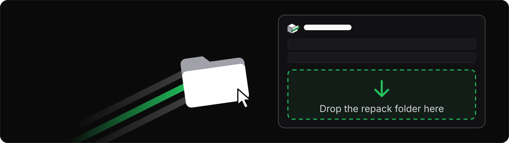

<p align="center"></p>

<p align="center">
  <a href="https://github.com/JoeyKhd/arc-unpacker/releases"></a>
  
  
</p>

# arc-unpacker

**Installs FitGirl-style repacks 1.7× faster than their own installer across 67 tested repacks (up to 3.9×), with byte-identical results.** It runs the installer's own install steps on a parallel engine, and checks every file while writing it.

**[→ Benchmarks: every game we tested, its own installer vs arc-unpack](docs/BENCHMARKS.md)**

<p align="center"></p>

## Use it

1. Download **`arc-unpack-gui.exe`** from the [latest release](https://github.com/JoeyKhd/arc-unpacker/releases). It's a single file.
2. Run it. It asks for administrator rights, as repack installers do.
3. Drop the repack folder onto the window, pick the optional parts you want, and press **Install**.

<p align="center"></p>

**Add a bonus or language pack later:** untick the base game, choose the folder the game is installed in, and press **Add to installed game**. The main `.bin` files don't need to be there anymore. Works on games installed by arc-unpack or by the repack's own installer.

**Short on RAM?** Tick **Limit RAM to** and set how many GB the install may use. It's slower.

From a terminal: `arc-unpack install "<repack folder>" "<game folder>"`.

> Use it only on archives you have the right to extract.

## Why it's faster

- **Archives are unpacked before the script asks for them.** While the installer's steps run one by one, the archives needed later are already being extracted, then moved into place at their step.
- **Every codec stage runs at once.** A chain like xtool → srep → lolz runs as concurrent processes instead of one after another. Memory-hungry stages share RAM safely.
- **Checking is free.** Files are hashed against the repack's MD5 list as they're written, so there's no second pass over the game.

More in [How it works](docs/HOW-IT-WORKS.md).

## Works with

- **Inno Setup + FreeArc repacks:** the format FitGirl uses "in 99.9% of cases". arc-unpack runs the installer's ISDone extraction steps and post-processing tools, with its CLS codecs (xtool, srep, lolz, …).
- **Check any repack in seconds, without installing:** `arc-unpack script "<repack folder>"` lists every step, or names what isn't supported.
- **Tested end to end** on 67 repacks ([benchmarks](docs/BENCHMARKS.md)). Every install was compared file by file with the original installer's output.

**Runtimes (DirectX, Visual C++, .NET):** if this PC is missing one the game needs, the window offers **Also install missing runtimes**. They're downloaded from the same Microsoft links the installer uses, checked for Microsoft's signature, and installed silently. Otherwise arc-unpack never connects to the internet.

Not done: an uninstaller, Start-menu entries or registry entries. Use **Create desktop shortcut** after installing, and delete the folder to uninstall.

## Build

```powershell
.\build.ps1              # -> dist\ : arc-unpack.exe, arc-unpack-gui.exe (self-contained)
cargo test --release     # unit and end-to-end tests
```

Requires Rust 1.85+ with the `x86_64-pc-windows-msvc` and `i686-pc-windows-msvc` targets, and the MSVC build tools.

## Acknowledgements

- [FreeArc](https://en.wikipedia.org/wiki/FreeArc) by Bulat Ziganshin, for the archive format, the CLS interface and `arc.ini` semantics (from the FreeArc 0.67 sources).
- [innoextract](https://constexpr.org/innoextract/) by Daniel Scharrer, for its documentation of the Inno Setup data layout.
- [RemObjects Pascal Script](https://github.com/remobjects/pascalscript), whose runtime defines the bytecode Inno Setup compiles install scripts into.
