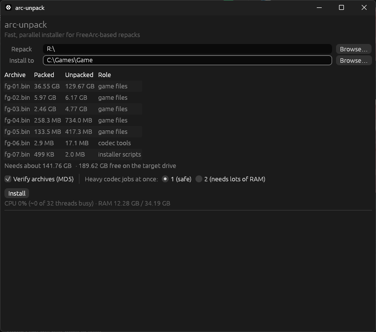

<p align="center"></p>

<p align="center">
  <a href="https://github.com/JoeyKhd/arc-unpacker/releases"></a>
  
  
</p>

# arc-unpacker

**A fast, parallel installer for FreeArc-based game repacks.** It runs the same codecs the repack's installer ships, but schedules them like a build system: every codec stage runs at once, independent archives run side by side, and files are written by a thread pool.

## How much faster?

**1.45× faster than the repack's own installer engine, and 1.53× with `--heavy-jobs 2`.** Measured on the same archives, the same codecs and the same machine:

| | Time | Speed-up |
|---|---:|---:|
| Original installer engine (`unarc.dll`, archive by archive) | 17 min 26 s | 1.00× |
| **arc-unpack** (default settings) | **12 min 1 s** | **1.45×** |
| **arc-unpack** `--heavy-jobs 2` | **11 min 23 s** | **1.53×** |

<sub>Test set: 4 archives of a 7-archive repack, 8.8 GB packed → 12.1 GB / 7,204 files. Every run produced the same files and bytes. Machine: Core i9-13900K (32 threads), 32 GB RAM, NVMe SSD, Windows 11, warm file cache. Details and how to reproduce: <a href="#benchmarks">Benchmarks</a>.</sub>

> Use it only on archives you have the right to extract.

## Download

Get **`arc-unpack-gui.exe`** from the [latest release](https://github.com/JoeyKhd/arc-unpacker/releases). It's a single self-contained file:

1. Run it. It asks for administrator rights, as repack installers do.
2. Pick the repack folder (or drop it onto the `.exe`) and an install folder.
3. Press **Install**.

<p align="center"></p>

Prefer a terminal? `arc-unpack.exe install <repack folder> <install folder>` does the same thing.

## Why it's faster

- **Every codec stage runs at once.** A chain like `xtool + precomp + srep + lolz` runs as four concurrent processes connected by large pipes.
- **Archives run side by side.** Light archives run alongside a heavy one, while memory-heavy codec chains are scheduled so they fit in RAM.
- **Fast output.** Files are created, preallocated, checksummed and timestamped by a pool of writer threads while decoding continues.
- **Native 64-bit, never throttled.** The pipeline isn't limited to a 32-bit process. Codec processes are opted out of Windows EcoQoS throttling, so they aren't parked on efficiency cores.

The remaining limit is the codecs themselves: context-mixing decoders such as lolz decode one solid stream on a single core. arc-unpack keeps everything around them out of the way.

## Features

- **One-click install.** The window, or `arc-unpack install`, does everything in one go:
  - prepares the repack's codecs straight from its Inno Setup `setup.exe`, without running it (every file SHA-1 verified);
  - checks the archives against the repack's MD5 list;
  - sorts the archives (game data, codec tools, installer scripts) and extracts them.
- **Resume.** If an install is interrupted, running it again skips the archives that already finished.
- **Works with what installers ship.** It reads FreeArc's `arc.ini` (external compressors), loads CLS codec DLLs (`cls-*.dll`) through 32- and 64-bit hosts, and falls back to the installer's own `unarc.dll` for FreeArc built-in methods.
- **Keeps misbehaving codecs in check:**
  - Every codec process lives in a kill-on-exit job object, so nothing is orphaned.
  - Codec error dialogs are closed automatically and their text is reported.
  - A stall watchdog stops hung codecs.
  - Codec start-up is serialized across processes, and the memory-heavy job limit is shared machine-wide, so two runs at once can't corrupt each other or exhaust RAM.
- **Safe extraction.** Archive paths are untrusted: `..`, absolute paths, drive letters, alternate data streams and device names are refused. Unlike the 32-bit `unarc.dll`, paths longer than 260 characters work.
- **Honest checksums.** It detects repacks that use a modified FreeArc checksum and reports those files as "complete but not CRC-checked" instead of inventing mismatches.

## Benchmarks

`bench/bench.ps1` extracts the same archives three ways:
- **Baseline:** each archive one after another through `unarc.dll`'s `FreeArcExtract`, which is what Inno Setup + ISDone installers call internally.
- **arc-unpack, default:** one `extract` run with `-j 3 --heavy-jobs 1`.
- **arc-unpack, `--heavy-jobs 2`:** the same run with two heavy jobs allowed.

Every run starts with the archives in the file cache, samples CPU and RAM every second, and is checked to produce the same file count and bytes. Raw data: [`bench/results.json`](bench/results.json).

| Run | Wall time | Avg CPU | Peak RAM in use |
|---|---:|---:|---:|
| Baseline: installer engine, archive by archive | 1,045.6 s | 19% | 31.5 GB |
| arc-unpack, default | 720.8 s | 16% | 26.5 GB |
| arc-unpack, `--heavy-jobs 2` | 682.8 s | 19% | 28.6 GB |

Baseline time per archive:

| Archive | Packed | Codec chain | Baseline |
|---|---:|---|---:|
| A | 5.97 GB | razor; mostly stored data | 10.4 s |
| B | 2.46 GB | xtool → precomp → srep → lolz-class | 954.6 s |
| C | 258 MB | srep → dispack → delta → razor (FreeArc built-ins, runs through `unarc.dll` in both) | 8.5 s |
| D | 134 MB | precomp → srep → lolz-class | 72.1 s |

What the numbers say:
- **Most of the gain is in archive B.** Its four codecs overlap in arc-unpack's pipeline, and the small archives finish in its shadow instead of after it.
- **The CPU is mostly idle in both.** Average use stays under 20% of 32 threads: lolz-class decoders are single-threaded, and that sets the floor.
- **The largest archive (36.5 GB) isn't in this table** because one run takes hours. It uses the same codec types as archive B.

Reproduce it from an administrator PowerShell, with codecs prepared as described under [Command line](#command-line):

```powershell
.\bench\bench.ps1 -Repack D:\repack -Archives data-02.bin,data-03.bin -Codecs D:\codecs -Work C:\bw
```

Keep `-Work` short: the 32-bit `unarc.dll` baseline can't write paths over 260 characters.

## Command line

```powershell
arc-unpack install  <repack> <target>        # one-step install (asks for admin rights; --dry-run to preview)
arc-unpack list     data-01.bin --files      # blocks, codec chains, sizes, files
arc-unpack extract-setup setup.exe -o tools  # unpack an Inno Setup 5.5 installer's files (never runs it)
arc-unpack import-arcini tools\tmp\arc.ini -o codecs.toml
arc-unpack check    *.bin -c codecs.toml     # does every method have a decoder?
arc-unpack test     *.bin -c codecs.toml     # decode and verify, write nothing
arc-unpack extract  *.bin -c codecs.toml -o D:\Games\Title
```

| Flag | Meaning |
|---|---|
| `-j, --jobs N` | Jobs at once. Light jobs fill in around heavy ones. |
| `--heavy-jobs N` | Memory-heavy jobs at once, machine-wide (default 1). lolz-class codecs size their buffers by a share of RAM. |
| `--writers N` | File writer threads per job. |
| `--stall-timeout S` | Stop a job after S seconds without progress (default 600, 0 = never). |
| `--overwrite`, `--skip-missing`, `--no-tune` | Replace existing files / extract what's decodable / leave priorities alone. |

### Codec configuration

`install` generates the configuration for you. To write one by hand:

```toml
codec_dir = 'C:\setup-tools\tmp'
unarc     = 'unarc.dll'            # whole-archive fallback for FreeArc built-ins

[methods.srep]                     # external program, piped
cmd = 'srep64.exe -d {options}- -'
header = false                     # arc.ini "header" flag byte

[methods.rzwb]                     # external program, temp files
cmd = 'rzw d {input} {output} 1023 1023'
header = false

[methods.magic2]                   # CLS DLL under another name
cls = 'cls-lolz_x64.dll'
```

Placeholders follow FreeArc's: `{options}`, `{X option Y}`, `{params}`, `{input}`, `{output}`, `{codec_dir}`. A `cls-<name>.dll` in `codec_dir` is used automatically. See [`codecs.example.toml`](codecs.example.toml).

## How it works

```
                      ┌────────────── one job ───────────────┐
 archive ─► reader ─► │ codec N ─► … ─► codec 2 ─► codec 1   │─► splitter ─► writer pool ─► files
            (4 MiB)   │ (process / thread per stage, pipes)  │   (by size)   (N threads, CRC)
                      └──────────────────────────────────────┘
 Jobs from different archives run side by side; heavy ones share a machine-wide limit.
 Archives that need FreeArc built-ins run whole through unarc.dll, in parallel with the rest.
```

| Codec kind | Source | How it runs |
|---|---|---|
| External program | `arc.ini` / `[methods.x] cmd = …` | Child process, piped or through temp files |
| CLS DLL | `cls-<name>.dll` | `cls-host-x86/x64`, matched to the DLL's architecture |
| Built-in | `storing`, `lzma` | In-process thread |
| FreeArc built-in (`delta`, `dispack`, `4x4`, `tor`, …) | `unarc.dll` | Whole archive via `unarc-host-x86` |

## Limitations

- **Windows 10/11 x64 only.** Installer extraction supports Inno Setup 5.5 Unicode installers.
- **Administrator rights are required by some codecs** (they create `Global\` shared memory), exactly as with the original installer.
- **Post-install scripts are not run.** Repack installers often run batch scripts after unpacking (moving files, restoring duplicates). arc-unpack sets them aside and lists them for you to review.
- **This is a beta.** Individual archives of a real repack have been verified end to end; a complete install of a full repack is still being validated.

## Building from source

```powershell
.\build.ps1              # -> dist\ : arc-unpack.exe, arc-unpack-gui.exe (self-contained) + helpers
cargo test --release     # 34 unit and end-to-end tests
```

Requires Rust 1.85+ with the `x86_64-pc-windows-msvc` and `i686-pc-windows-msvc` targets, and the MSVC build tools.

<details>
<summary>Project layout</summary>

```
src/format.rs          FreeArc container: footer, control blocks, directory, varints
src/inno.rs            read-only Inno Setup 5.5 Unicode extractor
src/install.rs         one-step install: scan, codec prep, MD5, roles, resume
src/extract.rs         scheduling, splitting, writer pool, watchdog, path safety
src/stage.rs           stage runners: built-ins, external programs, CLS hosts
src/config.rs          codecs.toml, method resolution, FreeArc option templates
src/guard.rs           job objects, dialog handling, cross-process locks, elevation
src/events.rs          progress events (terminal and GUI are listeners)
src/helpers.rs         embedded helper programs
src/bin/arc-unpack-gui.rs   the window (egui)
src/bin/cls-host.rs    CLS DLL host (x86 + x64)
src/bin/unarc-host.rs  unarc.dll host (x86)
tests/synthetic.rs     builds FreeArc archives byte by byte and runs the real binary
bench/bench.ps1        the benchmark
```
</details>

## Acknowledgements

- [FreeArc](https://en.wikipedia.org/wiki/FreeArc) by Bulat Ziganshin, for the archive format, the CLS interface and `arc.ini` semantics (from the FreeArc 0.67 sources).
- [innoextract](https://constexpr.org/innoextract/) by Daniel Scharrer, for its documentation of the Inno Setup data layout.
