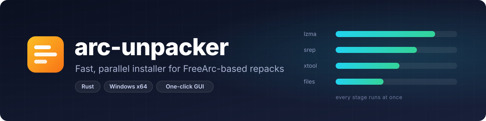

<p align="center"></p>

<p align="center">
  <a href="https://github.com/JoeyKhd/arc-unpacker/releases"></a>
  
  
</p>

# arc-unpacker

**A fast, parallel installer for FreeArc-based game repacks.** It runs the repack installer's own install script, with the same codecs and tools, so the result is identical. Underneath, it schedules everything like a build system: every codec stage runs at once, archives the script needs later are unpacked early, and files are written and checked by a thread pool.

## How much faster?

**3.4× faster than the repack's own installer, end to end, with default settings.** Same repack, same machine, both ending with a verified install:

| | Time | Speed-up |
|---|---:|---:|
| Original `setup.exe`, default options (unpack, then its "verify files" pass) | 4 min 47 s | 1.0× |
| Original `setup.exe`, unpacking only (verify pass skipped) | 3 min 20 s | 1.4× |
| **arc-unpack**, default (also checks the downloaded archives first) | **1 min 24 s** | **3.4×** |
| **arc-unpack** `--no-verify` (skips the archive check) | **1 min 15 s** | **3.8×** |

<sub>In every arc-unpack run, each installed file is checked against the repack's MD5 list while it's being written.</sub>

<sub>Test: a 5-archive repack, 4.7 GB packed → 8.1 GB / 3,489 files, whose installer also rebuilds audio banks and patches files after unpacking. arc-unpack ran the installer's own script; the result was **byte-for-byte identical** to the original installer's (every file compared). Core i9-13900K (32 threads), 32 GB RAM, NVMe SSD, Windows 11, file cache flushed before each run. Details: <a href="#benchmarks">Benchmarks</a>.</sub>

> Use it only on archives you have the right to extract.

## Download

Get **`arc-unpack-gui.exe`** from the [latest release](https://github.com/JoeyKhd/arc-unpacker/releases). It's a single self-contained file:

1. Run it. It asks for administrator rights, as repack installers do.
2. Pick the repack folder (or drop it onto the `.exe`) and an install folder.
3. Press **Install**.

<p align="center"></p>

Prefer a terminal? `arc-unpack.exe install <repack folder> <install folder>` does the same thing.

## Why it's faster

- **Archives are unpacked before the script asks for them.** arc-unpack reads the whole install script first. While the script works through one step, the archives it needs later are already being extracted into a staging folder. When the script reaches them, the files are moved into place, so the result is the same as running the steps in order.
- **Checking is free.** Every file is hashed against the repack's own MD5 list while it's being written, so there's no second read of the whole game afterwards.
- **Every codec stage runs at once.** A chain like `xtool + precomp + srep + lolz` runs as four concurrent processes connected by large pipes.
- **Archives run side by side.** Light archives run alongside a heavy one, while memory-heavy codec chains are scheduled so they fit in RAM.
- **Fast output.** Files are created, preallocated, checksummed and timestamped by a pool of writer threads while decoding continues.
- **Native 64-bit, never throttled.** The pipeline isn't limited to a 32-bit process. Codec processes are opted out of Windows EcoQoS throttling, so they aren't parked on efficiency cores.

The remaining limit is the codecs themselves: context-mixing decoders such as lolz decode one solid stream on a single core. arc-unpack keeps everything around them out of the way.

## Exactly what the installer does

A repack's `setup.exe` is an Inno Setup program. Its real work happens in a compiled Pascal Script inside it: which archives to unpack, in what order, and which tools to run on the results (rebuilding audio banks, applying patches, running `.bat` scripts, merging file lists). arc-unpack includes a small Pascal Script interpreter and runs that script itself, supplying the functions it calls:

- **Archive extraction** goes through arc-unpack's parallel engine.
- **The repack's own tools** run exactly as the script says, in the same order, without windows.
- **The installer's window**, progress bars and music are ignored.

The script runs under rules:

- It can only write and delete inside the game folder and its own temporary folder.
- The repack folder is read-only to it.
- It can only start programs from those folders, plus `cmd.exe`.

Preview what an installer will do without changing anything:

```text
> arc-unpack script "D:\Downloads\Some Repack"
Components (default install + downloaded optional parts):
  [x] text  Main game files
  [x] bonus  Bonus Content
Steps:
    1. extract D:\Downloads\Some Repack\data-optional-bonus.bin -> C:\Games\Game
    2. run cmd.exe /C x2.exe 01.pack 01.pack.x2&&del 01.pack.x2 (in C:\Games\Game)
   ...
```

If a script needs something arc-unpack doesn't provide, the install stops with a message that names it. `--no-script` extracts the archives directly instead.

## Features

- **One-click install.** The window, or `arc-unpack install`, does everything in one go:
  - reads the repack's Inno Setup `setup.exe` directly, without running it (every file SHA-1 verified);
  - checks the archives against the repack's MD5 list;
  - runs the installer's own install script with arc-unpack's engine underneath (see above);
  - checks every installed file against the repack's MD5 list, which replaces the installer's slow "verify files" pass.
- **Optional parts.** By default it installs what the installer installs by default, plus any optional part whose archive you downloaded (for example a bonus pack). `--components` picks them yourself, like `setup.exe /COMPONENTS=`.
- **Works with what installers ship.** It reads FreeArc's `arc.ini` (external compressors), loads CLS codec DLLs (`cls-*.dll`) through 32- and 64-bit hosts, and falls back to the installer's own `unarc.dll` for FreeArc built-in methods.
- **Keeps misbehaving codecs in check:**
  - Every codec process lives in a kill-on-exit job object, so nothing is orphaned.
  - Codec error dialogs are closed automatically and their text is reported.
  - A stall watchdog stops hung codecs.
  - Codec start-up is serialized across processes, and the memory-heavy job limit is shared machine-wide, so two runs at once can't corrupt each other or exhaust RAM.
- **Safe extraction.** Archive paths are untrusted: `..`, absolute paths, drive letters, alternate data streams and device names are refused. Unlike the 32-bit `unarc.dll`, paths longer than 260 characters work.
- **Honest checksums.** It detects repacks that use a modified FreeArc checksum and reports those files as "complete but not CRC-checked" instead of inventing mismatches.

## Benchmarks

### End to end: a whole install

A 5-archive repack (4.7 GB → 8.1 GB, 3,489 files) whose installer unpacks an optional bonus archive and two sets of audio data, then rebuilds the audio with its own tools in two chains of 12 steps. The file cache was flushed before each run.

| Run | Time | What it covers |
|---|---:|---|
| `setup.exe /VERYSILENT` (bonus selected) | 199.8 s | unpacking and post-processing |
| … then its default "verify files" pass (QuickSFV) | +86.9 s | MD5 of all 3,484 listed files |
| arc-unpack, steps one after another | 123 s | unpacking, post-processing and MD5 of every file |
| **arc-unpack `--no-verify`** (early extraction, 2nd heavy job) | **75 s** | the same |
| **arc-unpack, default** | **84 s** | the same, plus an MD5 check of the 5 downloaded archives first |

Where the time goes in the one-after-another run: the largest archive takes 70 s, the bonus archive 24 s, a third archive 13 s, and the installer's tools about 13 s across 26 steps. Early extraction overlaps all of that with the largest archive.

Correctness: the arc-unpack install was compared file by file with the original installer's. Every one of the 3,489 files was byte-identical. The only files missing were Inno's own uninstaller files.

### The decode engine alone

`bench/bench.ps1` extracts the same archives three ways:
- **Baseline:** each archive one after another through `unarc.dll`'s `FreeArcExtract`, which is what Inno Setup + ISDone installers call internally.
- **arc-unpack, `--heavy-jobs 1`:** one `extract` run with `-j 3 --heavy-jobs 1`.
- **arc-unpack, `--heavy-jobs 2`:** the same run with two heavy jobs allowed.

Every run starts with the archives in the file cache, samples CPU and RAM every second, and is checked to produce the same file count and bytes. Raw data: [`bench/results.json`](bench/results.json).

| Run | Wall time | Avg CPU | Peak RAM in use |
|---|---:|---:|---:|
| Baseline: installer engine, archive by archive | 1,045.6 s | 19% | 31.5 GB |
| arc-unpack, `--heavy-jobs 1` | 720.8 s | 16% | 26.5 GB |
| arc-unpack, `--heavy-jobs 2` | 682.8 s | 19% | 28.6 GB |

Baseline time per archive:

| Archive | Packed | Codec chain | Baseline |
|---|---:|---|---:|
| A | 5.97 GB | razor; mostly stored data | 10.4 s |
| B | 2.46 GB | xtool → precomp → srep → lolz-class | 954.6 s |
| C | 258 MB | srep → dispack → delta → razor (FreeArc built-ins, runs through `unarc.dll` in both) | 8.5 s |
| D | 134 MB | precomp → srep → lolz-class | 72.1 s |

What the numbers say:
- **Most of the gain is in archive B.** Its four codecs overlap in arc-unpack's pipeline, and the small archives finish in its shadow instead of after it.
- **The CPU is mostly idle in both.** Average use stays under 20% of 32 threads: lolz-class decoders are single-threaded, and that sets the floor.
- **The largest archive (36.5 GB) isn't in this table** because one run takes hours. It uses the same codec types as archive B.

Reproduce it from an administrator PowerShell, with codecs prepared as described under [Command line](#command-line):

```powershell
.\bench\bench.ps1 -Repack D:\repack -Archives data-02.bin,data-03.bin -Codecs D:\codecs -Work C:\bw
```

Keep `-Work` short: the 32-bit `unarc.dll` baseline can't write paths over 260 characters.

## Command line

```powershell
arc-unpack install  <repack> <target>        # one-step install (asks for admin rights; --dry-run to preview)
arc-unpack script   <repack>                 # what the installer's script would do (changes nothing)
arc-unpack script   <repack> --disasm CurStepChanged   # its bytecode, for the curious
arc-unpack list     data-01.bin --files      # blocks, codec chains, sizes, files
arc-unpack extract-setup setup.exe -o tools  # unpack an Inno Setup 5.5 installer's files (never runs it)
arc-unpack import-arcini tools\tmp\arc.ini -o codecs.toml
arc-unpack check    *.bin -c codecs.toml     # does every method have a decoder?
arc-unpack test     *.bin -c codecs.toml     # decode and verify, write nothing
arc-unpack extract  *.bin -c codecs.toml -o D:\Games\Title
```

| Flag | Meaning |
|---|---|
| `-j, --jobs N` | Jobs at once. Light jobs fill in around heavy ones. |
| `--heavy-jobs N` | Memory-heavy jobs at once, machine-wide (default 2). The first always runs; the others start only while at least a quarter of RAM (and 8 GB) is free. |
| `--components a,b` | `install`: components to install (default: the installer's defaults plus downloaded optional parts). |
| `--no-script` | `install`: don't run the installer's script; extract every archive into the target. |
| `--writers N` | File writer threads per job. |
| `--stall-timeout S` | Stop a job after S seconds without progress (default 600, 0 = never). |
| `--overwrite`, `--skip-missing`, `--no-tune` | Replace existing files / extract what's decodable / leave priorities alone. |

### Codec configuration

`install` generates the configuration for you. To write one by hand:

```toml
codec_dir = 'C:\setup-tools\tmp'
unarc     = 'unarc.dll'            # whole-archive fallback for FreeArc built-ins

[methods.srep]                     # external program, piped
cmd = 'srep64.exe -d {options}- -'
header = false                     # arc.ini "header" flag byte

[methods.rzwb]                     # external program, temp files
cmd = 'rzw d {input} {output} 1023 1023'
header = false

[methods.magic2]                   # CLS DLL under another name
cls = 'cls-lolz_x64.dll'
```

Placeholders follow FreeArc's: `{options}`, `{X option Y}`, `{params}`, `{input}`, `{output}`, `{codec_dir}`. A `cls-<name>.dll` in `codec_dir` is used automatically. See [`codecs.example.toml`](codecs.example.toml).

## How it works

```
                      ┌────────────── one job ───────────────┐
 archive ─► reader ─► │ codec N ─► … ─► codec 2 ─► codec 1   │─► splitter ─► writer pool ─► files
            (4 MiB)   │ (process / thread per stage, pipes)  │   (by size)   (N threads, CRC)
                      └──────────────────────────────────────┘
 Jobs from different archives run side by side; heavy ones share a machine-wide limit.
 Archives that need FreeArc built-ins run whole through unarc.dll, in parallel with the rest.
```

| Codec kind | Source | How it runs |
|---|---|---|
| External program | `arc.ini` / `[methods.x] cmd = …` | Child process, piped or through temp files |
| CLS DLL | `cls-<name>.dll` | `cls-host-x86/x64`, matched to the DLL's architecture |
| Built-in | `storing`, `lzma` | In-process thread |
| FreeArc built-in (`delta`, `dispack`, `4x4`, `tor`, …) | `unarc.dll` | Whole archive via `unarc-host-x86` |

## Limitations

- **Windows 10/11 x64 only.** Installer extraction supports Inno Setup 5.5 Unicode installers.
- **Administrator rights are required by some codecs** (they create `Global\` shared memory), exactly as with the original installer.
- **The installer's script is emulated, not the whole installer.** Scripts are supported when they use the functions repack installers use: ISDone extraction, running programs, files and INI settings. Anything else stops the install with a message naming the missing function.
- **No uninstaller or shortcuts.** To uninstall, delete the game folder. Redistributables such as DirectX and VC++ are not installed.
- **No resume while running the script.** An interrupted script-driven install starts over. With `--no-script`, finished archives are skipped on a rerun.
- **This is a beta.** Tested end to end on two FitGirl repacks with different post-processing (audio rebuilding, patches, batch scripts).

## Building from source

```powershell
.\build.ps1              # -> dist\ : arc-unpack.exe, arc-unpack-gui.exe (self-contained) + helpers
cargo test --release     # 43 unit and end-to-end tests
```

Requires Rust 1.85+ with the `x86_64-pc-windows-msvc` and `i686-pc-windows-msvc` targets, and the MSVC build tools.

<details>
<summary>Project layout</summary>

```
src/format.rs          FreeArc container: footer, control blocks, directory, varints
src/inno.rs            read-only Inno Setup 5.5 Unicode extractor (files, components, compiled code)
src/pascal.rs          Pascal Script (IFPS) bytecode interpreter
src/setup_script.rs    the Inno Setup / ISDone functions an install script calls
src/install.rs         one-step install: script run, early extraction, MD5 checks
src/extract.rs         scheduling, splitting, writer pool, watchdog, path safety
src/stage.rs           stage runners: built-ins, external programs, CLS hosts
src/config.rs          codecs.toml, method resolution, FreeArc option templates
src/guard.rs           job objects, dialog handling, cross-process locks, elevation
src/events.rs          progress events (terminal and GUI are listeners)
src/helpers.rs         embedded helper programs
src/bin/arc-unpack-gui.rs   the window (egui)
src/bin/cls-host.rs    CLS DLL host (x86 + x64)
src/bin/unarc-host.rs  unarc.dll host (x86)
tests/synthetic.rs     builds FreeArc archives byte by byte and runs the real binary
bench/bench.ps1        the benchmark
```
</details>

## Acknowledgements

- [FreeArc](https://en.wikipedia.org/wiki/FreeArc) by Bulat Ziganshin, for the archive format, the CLS interface and `arc.ini` semantics (from the FreeArc 0.67 sources).
- [innoextract](https://constexpr.org/innoextract/) by Daniel Scharrer, for its documentation of the Inno Setup data layout.
