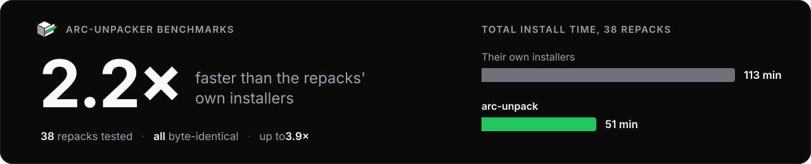

# Benchmarks

38 FitGirl repacks, each installed by its own installer and by arc-unpack, one at a time on the same PC. **Version** is the arc-unpack version each game was last measured with.

| Game | Download | Original installer | arc-unpack | Faster | Version |
|---|---:|---:|---:|---:|---|
| Blitzkrieg 3 | 1.7 GB | 1 min 43 s | 26 s | **3.9×** | 0.1.0-beta.6 |
| Hearts of Iron IV | 4.6 GB | 5 min 40 s | 1 min 27 s | **3.9×** | 0.1.0-beta.8 |
| Hollow Knight - Silksong | 1.8 GB | 1 min 56 s | 30 s | **3.9×** | 0.1.0-beta.6 |
| Void Reaver | 2.1 GB | 1 min 18 s | 20 s | **3.9×** | 0.1.0-beta.8 |
| Crusader Kings 3 | 6.0 GB | 6 min 16 s | 1 min 41 s | **3.7×** | 0.1.0-beta.7 |
| Minecraft - Bedrock Edition | 0.7 GB | 2 min 22 s | 41 s | **3.5×** | 0.1.0-beta.6 |
| God of War III Remastered | 30.0 GB | 6 min 14 s | 1 min 49 s | **3.4×** | 0.1.0-beta.7 |
| Castlevania - Belmont's Curse | 5.1 GB | 3 min 40 s | 1 min 09 s | **3.2×** | 0.1.0-beta.6 |
| Factorio | 4.9 GB | 9 min 57 s | 3 min 04 s | **3.2×** | 0.1.0-beta.8 |
| Bendy and the Dark Revival | 3.0 GB | 1 min 40 s | 33 s | **3.0×** | 0.1.0-beta.8 |
| Slime Rancher 2 | 1.7 GB | 2 min 29 s | 50 s | **3.0×** | 0.1.0-beta.6 |
| Cities - Skylines | 7.6 GB | 3 min 51 s | 1 min 21 s | **2.9×** | 0.1.0-beta.8 |
| Probably Stolen | 0.6 GB | 29 s | 10 s | **2.9×** | 0.1.0-beta.7 |
| Flick | 2.1 GB | 54 s | 19 s | **2.8×** | 0.1.0-beta.6 |
| Halls of Torment | 0.9 GB | 34 s | 13 s | **2.7×** | 0.1.0-beta.8 |
| Stardew Valley | 0.4 GB | 36 s | 14 s | **2.6×** | 0.1.0-beta.7 |
| Cuphead | 4.3 GB | 2 min 34 s | 1 min 03 s | **2.5×** | 0.1.0-beta.8 |
| Dice Hoarder | 1.5 GB | 2 min 04 s | 49 s | **2.5×** | 0.1.0-beta.8 |
| Hollow Knight | 1.1 GB | 1 min 24 s | 33 s | **2.5×** | 0.1.0-beta.7 |
| Moadra | 3.3 GB | 50 s | 22 s | **2.3×** | 0.1.0-beta.6 |
| Silver Pines | 2.1 GB | 2 min 28 s | 1 min 04 s | **2.3×** | 0.1.0-beta.8 |
| BALL x PIT | 0.4 GB | 50 s | 22 s | **2.2×** | 0.1.0-beta.8 |
| Dinkum | 0.9 GB | 1 min 07 s | 30 s | **2.2×** | 0.1.0-beta.6 |
| Penguin Colony | 1.2 GB | 1 min 06 s | 30 s | **2.2×** | 0.1.0-beta.8 |
| BOXROOM | 1.3 GB | 1 min 01 s | 29 s | **2.1×** | 0.1.0-beta.8 |
| over the hill | 2.1 GB | 3 min 35 s | 1 min 44 s | **2.1×** | 0.1.0-beta.8 |
| Sekiro - Shadows Die Twice | 9.5 GB | 6 min 46 s | 3 min 15 s | **2.1×** | 0.1.0-beta.7 |
| Hozy | 5.2 GB | 2 min 31 s | 1 min 16 s | **2.0×** | 0.1.0-beta.8 |
| 771 - Smile and Work | 0.7 GB | 24 s | 12 s | **1.9×** | 0.1.0-beta.6 |
| Football Manager 27 | 4.7 GB | 6 min 48 s | 3 min 32 s | **1.9×** | 0.1.0-beta.8 |
| Goat Simulator 3 | 5.5 GB | 3 min 18 s | 1 min 45 s | **1.9×** | 0.1.0-beta.8 |
| Revenge of the Mage | 6.1 GB | 3 min 45 s | 2 min 00 s | **1.9×** | 0.1.0-beta.8 |
| Serious Sam Fusion | 4.6 GB | 2 min 29 s | 1 min 20 s | **1.9×** | 0.1.0-beta.6 |
| The Killing Stone | 4.4 GB | 1 min 58 s | 1 min 04 s | **1.9×** | 0.1.0-beta.6 |
| Football Manager 2023 | 2.3 GB | 2 min 40 s | 1 min 40 s | **1.6×** | 0.1.0-beta.8 |
| Red Dead Redemption | 6.4 GB | 5 min 18 s | 3 min 48 s | **1.4×** | 0.1.0-beta.7 |
| Tokyo Xtreme Racer | 8.3 GB | 3 min 34 s | 2 min 51 s | **1.3×** | 0.1.0-beta.6 |
| REANIMAL | 10.2 GB | 7 min 14 s | 6 min 27 s | **1.1×** | 0.1.0-beta.8 |
| **All 38** | | **113 min 24 s** | **51 min 22 s** | **2.2×** | |

- **Original installer:** the repack's `setup.exe`, timed until its default file check (QuickSFV) finished.
- **arc-unpack:** default settings, which check the downloaded archives and every installed file.
- **Same result:** all 38 installs were byte-identical to the original installer's.
- **Same conditions:** the same parts in both, and the file cache flushed before every run.

Test PC: Intel Core i9-13900K, 32 GB DDR5-5600, Samsung 990 PRO 2 TB NVMe SSD, Windows 11 Pro.

Every run is kept in [`bench/ledger.jsonl`](../bench/ledger.jsonl), so a new version only needs measuring on the games it should change. To measure, run `.\bench\compare.ps1 -Repacks <folders> -SkipOriginal` from an administrator PowerShell, then `python bench\ledger.py add bench\results\*.json`. `python bench\ledger.py docs` then updates this table, the banner above and the README's headline, and `python bench\ledger.py table` shows every version side by side.
