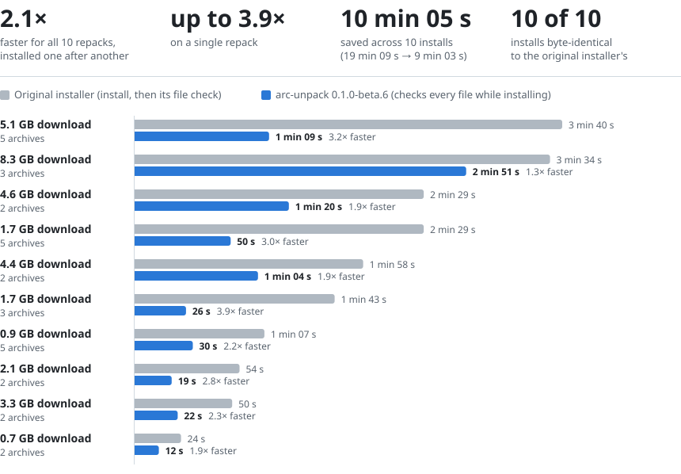

# Benchmarks

**Test PC for every run:** Intel Core i9-13900K (24 cores, 32 threads), 32 GB DDR5-5600, Samsung 990 PRO 2 TB NVMe M.2 SSD, Windows 11 Pro, with Windows' 1 ms timer setting on (`GlobalTimerResolutionRequests`).

<p align="center">
  <picture>
    <source media="(prefers-color-scheme: dark)" srcset="benchmark-dark.svg">
    <source media="(prefers-color-scheme: light)" srcset="benchmark-light.svg">
    
  </picture>
</p>

## Ten repacks

Measured on 2026-11-25 with [`bench/compare.ps1`](../bench/compare.ps1), one repack at a time:

- **The original:** the repack's `setup.exe /VERYSILENT`, timed until its default post-install file check (QuickSFV) finished working.
- **arc-unpack 0.1.0-beta.6:** default settings, which check the downloaded archives and every installed file against the repack's MD5 lists.
- **Same parts** in both: the main game, plus the bonus content where the repack has one. The DirectX / VC++ installers were left out of both, because arc-unpack doesn't run them.
- **Fair start:** the file cache was flushed before every run, and every install went into an empty folder.
- **Checked:** every arc-unpack install was compared file by file (MD5) with the original installer's.
- **Background:** the torrent client was running during all runs.

| Repack (torrent info hash) | Archives | Download | Original: install + check | Original total | arc-unpack 0.1.0-beta.6 | Speed-up | Same files |
|---|---:|---:|---:|---:|---:|---:|:---:|
| `ec1293112618` | 5 | 5.1 GB | 3 min 11 s + 30 s | 3 min 40 s | 1 min 09 s | **3.2×** | yes |
| `c067eb128cf8` | 3 | 8.3 GB | 3 min 00 s + 34 s | 3 min 34 s | 2 min 51 s | **1.3×** | yes |
| `2ac6382a0c41` | 5 | 1.7 GB | 2 min 12 s + 17 s | 2 min 29 s | 50 s (3 runs) | **3.0×** | yes |
| `2482f76d24d0` | 2 | 4.6 GB | 1 min 53 s + 36 s | 2 min 29 s | 1 min 20 s | **1.9×** | yes |
| `63d0309fce6a` | 2 | 4.4 GB | 1 min 37 s + 21 s | 1 min 58 s | 1 min 04 s | **1.9×** | yes |
| `57c5b9c09793` | 3 | 1.7 GB | 1 min 04 s + 40 s | 1 min 43 s | 26 s | **3.9×** | yes |
| `b9926a4a2349` | 5 | 0.9 GB | 51 s + 16 s | 1 min 07 s | 30 s | **2.2×** | yes |
| `5e9c000941fa` | 2 | 2.1 GB | 23 s + 31 s | 54 s | 19 s | **2.8×** | yes |
| `9eaa6bc5e96c` | 2 | 3.3 GB | 25 s + 25 s | 50 s | 22 s | **2.3×** | yes |
| `e0138fc09db2` | 2 | 0.7 GB | 17 s + 7 s | 24 s | 12 s | **1.9×** | yes |
| **All 10** | | | | **19 min 09 s** | **9 min 03 s** | **2.1×** | |

**Why the speed-ups differ.**

- **Several archives and post-processing steps (2.8× to 3.9×).** These have the most to overlap: archives unpack side by side, and the installer's tools run while later archives decode. The original's separate check pass is also a large share of its time.
- **One large block (1.3×).** `c067eb128cf8` is almost entirely one 7.8 GB block. Its slowest decoder, the repack's own `rtool` (an xtool variant), keeps 22 of 32 threads busy on its own. Both installers wait for it; arc-unpack saves the check pass and the smaller archives.
- **Two archives (1.9× to 2.3×).** Less to overlap, so the gain is mostly the check pass.

**Found by this run, fixed in 0.1.0-beta.6.** The first pass used 0.1.0-beta.5, which failed on three of the ten repacks:

- **Two repacks** ship an `arc.ini` that names a decoder program the installer doesn't include, or no decode command at all. The installer ships a CLS plugin for that method instead, and FreeArc decodes with the plugin. beta.6 does the same.
- **One repack's Razor decoder** keeps a fixed-name temp file in its working folder, so two copies running at once crash. beta.5 ran every codec in the shared codec folder, and failed on that repack in 2 of 3 runs. beta.6 gives each codec process its own folder, as FreeArc does, and succeeded in 3 of 3.

**Correction.** Earlier versions of this page gave 4 min 47 s for the original installer on the 5-archive repack below. That run timed the file check until QuickSFV's window was closed, which included time the window sat idle. Timed to the end of its work, the original takes 3 min 40 s, so the speed-up on that repack is 3.2×, not 3.9×. The ledger keeps the old run, marked as not comparable.

## One repack in detail

`ec1293112618`: 5 archives (4.7 GB → 8.1 GB, 3,489 files). Its installer unpacks an optional bonus archive and two sets of audio data, then rebuilds the audio with its own tools: 35 script steps in all.

| Run | Time | Speed-up | Avg CPU | What it covers |
|---|---:|---:|---:|---|
| `setup.exe /VERYSILENT` (bonus selected) | 190.6 s | | | unpacking and post-processing |
| … then its default file check (QuickSFV) | +29.7 s | | | MD5 of all 3,484 listed files |
| **Original installer, total** | **220.4 s** | 1.0× | 31% | |
| **arc-unpack 0.1.0-beta.6, default** | **69.3 s** | **3.2×** | 70% | unpacking, post-processing, MD5 of every file, MD5 of the 5 downloaded archives |

- **Throughput.** arc-unpack writes 9.19 GB (the 8.1 GB game plus intermediate files the installer's tools consume and delete), at about 130 MB/s.
- **Memory.** RAM in use rose by 12.2 GB under the original installer and by 14.0 GB under arc-unpack.
- **Repeatable.** beta.5 took 72.8 s, 74.3 s, 77.6 s, 73.6 s and 72.2 s in five runs on this repack.

**Correctness.** Each arc-unpack install of this repack that was compared file by file with the original installer's (one on beta.5, one on beta.6) was byte-identical; the only files missing are Inno Setup's own uninstaller files. Every other run wrote the same 3,489 files and 8,104,388,627 bytes, with all 3,484 files on the repack's MD5 list matching.

How it got here, on the same repack (median times; all versions are in the [ledger](../bench/ledger.jsonl)):

| Version | Time | What changed |
|---|---:|---|
| Steps one after another | 123 s | the installer's script on the parallel engine, with the MD5 of every file done while writing |
| beta.3 | 84 s | early extraction, a second memory-heavy job, and an MD5 check of the downloaded archives before the install |
| beta.5 | 74 s | that check runs during the install; the largest archive starts first |
| **beta.6** | **69 s** | each codec process runs in its own working folder (one run) |

## Everything fits inside the largest archive

One after another, the parts of this install add up:

| Part | On its own |
|---|---:|
| Largest archive (xtool → srep → lolz-class; 3,069 files, 5.80 GB) | 70 s |
| Bonus archive (330 files, 1.91 GB) | 24 s |
| A third archive (537 MB) | 13 s |
| The installer's own tools and the two inner archives they produce | about 13 s |

With early extraction they overlap. In the three beta.5 runs the largest archive took 71 s to 76 s of the 73 s to 78 s total, and everything else finished inside that window: the other four archives, 28 runs of the installer's tools, and every MD5 check.

## How close to the limit

Each stage of the largest archive was measured on its own, to see what's left to gain:

| Measured on the largest archive | Result |
|---|---:|
| lolz-class decoder alone (4.0 GB → 9.5 GB) | 23.5 s |
| xtool alone, input ready (15 GB → 5.8 GB of game files) | about 62 s |
| … at 75% to 200% thread settings | 62–67 s |
| … at 50% | 79.6 s |
| All three stages connected, three runs | 72.1 s, 75.2 s, 76.1 s |
| **The whole install** | **74 s** |

- **xtool sets the pace.** It's the repack's own build, it keeps 18–19 of 32 threads busy at any thread setting from 75% up, and it needs about 62 s even when its input is instant.
- **The install is within about 12 s of that.** Process priorities, larger buffers between stages and larger transfer buffers were all measured and made no difference.
- **What could still help** is outside the decoding: unpacking each archive as soon as its download finishes.

## The ledger

Every measured install goes into [`bench/ledger.jsonl`](../bench/ledger.jsonl), one line per run: the repack, the installer and its version, the time, the files written, and whether they match the original installer's. Each new version is measured on the same repacks, so the ledger shows how it compares with the original installers and with every earlier version.

- **No names.** Repacks are recorded by their torrent's info hash, plus the MD5 of the repack's own MD5 list for copies that didn't come from a torrent.
- **Measure:** from an administrator PowerShell, `.\bench\compare.ps1 -Repacks '<repack folder>', ...` runs the repack's own installer and then arc-unpack, with the same parts, the file cache flushed before each, and every file compared. Add `-SkipOriginal -Runs 3` to measure a new arc-unpack version only; its files are still compared with the original installer's saved file list.
- **Record:** `python bench\ledger.py add bench\results\*.json`
- **Compare:** `python bench\ledger.py table` prints the latest results per repack and arc-unpack's time per version.

## The decode engine alone

Before arc-unpack ran installers' scripts, this compared only the decoding, on a second repack. `bench/bench.ps1` extracts the same archives three ways:

- **Baseline:** each archive one after another through `unarc.dll`'s `FreeArcExtract`, which is what Inno Setup + ISDone installers call internally.
- **arc-unpack, `--heavy-jobs 1`:** one `extract` run with `-j 3 --heavy-jobs 1`.
- **arc-unpack, `--heavy-jobs 2`:** the same run with two heavy jobs allowed.

Every run starts with the archives in the file cache, samples CPU and RAM every second, and is checked to produce the same file count and bytes. Raw data: [`bench/results.json`](../bench/results.json).

| Run | Wall time | Avg CPU | Peak RAM in use |
|---|---:|---:|---:|
| Baseline: installer engine, archive by archive | 1,045.6 s (17 min 26 s) | 19% | 31.5 GB |
| arc-unpack, `--heavy-jobs 1` | 720.8 s (1.45×) | 16% | 26.5 GB |
| arc-unpack, `--heavy-jobs 2` | 682.8 s (11 min 23 s, 1.53×) | 19% | 28.6 GB |

Baseline time per archive (4 archives of a 7-archive repack, 8.8 GB → 12.1 GB / 7,204 files):

| Archive | Packed | Codec chain | Baseline |
|---|---:|---|---:|
| A | 5.97 GB | razor; mostly stored data | 10.4 s |
| B | 2.46 GB | xtool → precomp → srep → lolz-class | 954.6 s |
| C | 258 MB | srep → dispack → delta → razor (FreeArc built-ins, runs through `unarc.dll` in both) | 8.5 s |
| D | 134 MB | precomp → srep → lolz-class | 72.1 s |

What the numbers say:

- **Most of the gain is in archive B.** Its four codecs overlap in arc-unpack's pipeline, and the small archives finish in its shadow instead of after it.
- **The CPU is mostly idle in both.** Average use stays under 20% of 32 threads. lolz-class decoders are single-threaded, and that sets the floor.
- **The largest archive (36.5 GB) isn't in this table,** because one run takes hours. It uses the same codec types as archive B.

Reproduce it from an administrator PowerShell, with codecs prepared as described in [How it works](HOW-IT-WORKS.md#codec-configuration):

```powershell
.\bench\bench.ps1 -Repack D:\repack -Archives data-02.bin,data-03.bin -Codecs D:\codecs -Work C:\bw
```

Keep `-Work` short: the 32-bit `unarc.dll` baseline can't write paths over 260 characters.

The chart at the top is generated by [`tools/benchmark-chart.py`](../tools/benchmark-chart.py).
